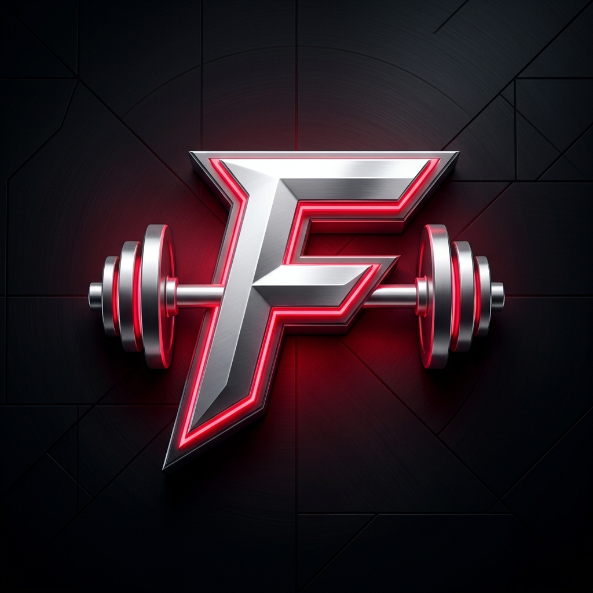

# ⚡ FitMax — Pure Home Bodyweight Fitness

<div align="center">



<br />
<br />

**Aplicativo mobile de alta performance para treinos calistênicos e exercícios funcionais em casa — 100% sem máquinas e sem equipamento.**

[](https://expo.dev/)
[](https://reactnative.dev/)
[](https://react.dev/)
[](https://www.typescriptlang.org/)
[](https://zustand-demo.pmnd.rs/)
[](LICENSE)

[Funcionalidades](#-funcionalidades-e-recursos-principais) •
[Tecnologias](#-tecnologias-utilizadas) •
[Estrutura do Projeto](#-estrutura-completa-do-projeto) •
[Arquivos Principais](#-explicação-dos-arquivos-principais) •
[Como Rodar](#-como-rodar-o-projeto) •
[Testes](#-testes-e-validação)

</div>

---

## 📱 Visão Geral

O **FitMax** é um aplicativo mobile focado no conceito de calistenia pura em casa. Todo o catálogo, filtros, rotinas e mecânicas de treino foram rigorosamente construídos para que **qualquer pessoa possa treinar em qualquer lugar utilizando unicamente o peso do próprio corpo, o chão ou uma parede de apoio**.

- 🚀 **100% Compatível com Expo Go (SDK 58)** tanto no Android quanto no iOS.
- 📴 **Offline-First Completo**: Catálogo embutido de **226 exercícios**, GIFs anatômicos em loop com cache, armazenamento local persistente via AsyncStorage e zero dependência obrigatória de APIs externas pagas.
- 🎨 **Interface Moderna & Esportiva**: Design escuro/claro dinâmico, tipografia esportiva (*Outfit* e *Plus Jakarta Sans*), pílula animada com feedback háptico na navegação e componentes fluidos a 60 fps construídos com React Native Reanimated.

---

## ✨ Funcionalidades e Recursos Principais

### 1. 🏠 Tela de Início (Home)
- **Carrossel de Destaques Dinâmico**: Banners motivacionais com calistenia e foco em treinos sem equipamento.
- **8 Categorias de Grupos Musculares Livres**:
  - *Cardio*, *Peitoral*, *Abdômen & Core*, *Costas*, *Pernas & Glúteos*, *Ombros*, *Braços* e *Panturrilhas*.
- **Cards com Fotos Temáticas em Alta Resolução**: Capas curadas representativas de cada categoria de exercício calistênico.
- **Resumo da Semana (Central de Notificações / Ícone de Sino)**:
  - Contador de dias seguidos acessando o aplicativo (*Login Streak*).
  - Métricas de treinos feitos e tempo ativo nos últimos 7 dias.
  - Gráfico de frequência diária com legenda interativa (treino concluído vs. dia logado).
  - Totalmente adaptado para safe area, com rolagem fluida e botão de fechar acessível em qualquer dispositivo.

### 2. 📖 Catálogo & Detalhes de Exercícios
- **Animações Anatômicas em Loop**: Reprodução de alta performance de GIFs/WebPs com renderização acelerada por hardware via `expo-image`.
- **Filtro Estrito Home-Friendly**: Exclusão automática de exercícios que demandem barras fixas, paralelas, argolas, halteres ou bancos.
- **Passo a Passo Bilíngue**: Tradução e localização integral de títulos, instruções de execução, músculos alvo e sinergistas em **Português (pt-BR)** e **Inglês (en)**.
- **Acesso Rápido ao Timer e Favoritos**: Adicione qualquer exercício aos favoritos para acesso instantâneo ou dispare o cronômetro diretamente a partir do detalhe do movimento.

### 3. ⏱️ Cronômetro Inteligente (Livre & Regressivo)
- **Dois Modos de Treino**:
  - **Cronômetro Livre (Stopwatch)**: Contagem progressiva milissegundo a milissegundo.
  - **Contagem Regressiva (Countdown)**: Definição de tempo-alvo do exercício com anel animado SVG (`TimerRing`).
- **Sinais Hápticos e Sonoros**: Efeitos sonoros (`beep-start.wav` e `beep-finish.wav`) e vibrações com `expo-haptics` ao iniciar e ao zerar a contagem.
- **Tela Mantida Acesa (`Keep Awake`)**: A tela não bloqueia nem desliga durante o treino.
- **Filtro de Busca e Transição Instantânea**: Troca de abas ultra-otimizada entre *Favoritos*, *Todos* e categorias musculares com indexação $O(1)$ em memória.

### 4. 📋 Gestão de Treinos & Gerador Personalizado
- **Criação Manual Intuitiva**:
  - Definição do nome do treino e descanso padrão entre séries (30s, 45s, 60s, 90s, 120s).
  - Seleção múltipla de exercícios com ordenação interativa (subir/descer) e ajuste individual de séries planejadas e tempo de descanso.
  - Botão **"SALVAR TREINO"** centralizado e área de toque tracejada intuitiva para adicionar novos exercícios.
- **✨ Gerador de Treino Personalizado Inteligente**:
  - Card dedicado de atalho na tela de treinos.
  - Seleção de nível: **Iniciante**, **Intermediário** ou **Avançado** (com volume de séries, repetições e tempos de descanso calibrados biometricamente).
  - Escolha do grupo muscular alvo ou da modalidade **Full-Body (Corpo Inteiro)** com rotação equilibrada de grupos musculares.
  - Prévia em tempo real com botão para **trocar exercícios** antes de salvar na lista.
- **Ações Rápidas**: Duplicação em 1 toque, edição e exclusão segura com diálogos modais temáticos.

### 5. ⚡ Sessão de Treino Ativa (Live Session)
- **Execução Série a Série**: Marcadores visuais interativos para registrar as séries concluídas.
- **Adição e Remoção de Séries em Tempo Real**: Adicione séries extras ou remova séries planejadas durante a execução sem sair da tela.
- **Timer de Descanso entre Séries**: Contagem regressiva de descanso em segundo plano com botões de ajuste rápido (`+15s`, `-15s` e `Pular descanso`).
- **Menu "Pular para Exercício"**: Folha modal deslizante protegida com safe area para navegar diretamente a qualquer exercício do treino.
- **Botão "FINALIZAR TREINO" com Proteção de Safe Area**: Totalmente desobstruído da barra de navegação virtual do sistema Android.
- **Resumo do Treino Concluído**: Tela de celebração com duração total, volume de séries, exercícios feitos e atalho para o Histórico.

### 6. 👤 Perfil, IMC, Evolução de Peso e Aparência
- **Foto de Perfil com Cortador 1:1 Nativo (`PhotoCropperModal`)**:
  - Ferramenta interna construída sobre `expo-image-manipulator` com grade 3x3 dos terços, controles de zoom, arrasto (pan) e rotação de 90° em 90°, com botão destacado **"CONCLUIR"**.
- **Calculadora de IMC com Medidor em Arco SVG (`BmiGauge`)**:
  - Classificação visual pelas faixas oficiais da Organização Mundial da Saúde (Abaixo do peso, Normal, Sobrepeso e Obesidade I, II e III).
  - **Modo Simulação**: Teste pesos e alturas sem alterar os dados salvos do perfil.
- **Gráfico de Evolução de Peso SVG (`WeightChart`)**:
  - Registro de pesagens com data e horário exatos.
  - Linha contínua com gradiente sombreado, marcadores de pontos e indicador de variação em kg.
- **Aparência do Aplicativo**:
  - Alternância perfeita entre **Modo Escuro (Dark)** e **Modo Claro (Light)** com ajuste automático de contraste em todos os textos, cartões e diálogos.

---

## 🛠️ Tecnologias Utilizadas

| Camada | Tecnologia | Propósito / Benefício |
|---|---|---|
| **Core Framework** | `React Native 0.88.1` + `React 19.3.0` | Base nativa de última geração compatível com Expo SDK 58. |
| **Plataforma & Build**| `Expo SDK ~58.0.22` | Ferramental completo para execução ágil no **Expo Go** e compilação na nuvem via EAS. |
| **Navegação** | `expo-router ~58.0.29` | Navegação declarativa baseada em arquivos com abas customizadas e pilhas tipadas. |
| **Gerenciamento de Estado** | `zustand ^5.0.15` | Estado atômico, leve e reativo com middleware `persist` e reidratação garantida. |
| **Armazenamento Local** | `@react-native-async-storage/async-storage 2.2.0` | Persistência offline-first sem perda de dados. |
| **Animações Fluidas** | `react-native-reanimated 4.7.1` + `worklets 0.13.0` | Animações a 60 fps na thread de UI nativa sem sobrecarregar a bridge JS. |
| **Gestos e Toques** | `react-native-gesture-handler ~3.3.0` | Reconhecimento nativo de toques, arrasto e gestos. |
| **Mídia e Imagens** | `expo-image ~58.0.18` | Decodificação nativa de GIFs anatômicos com reciclagem de memória e cache. |
| **Manipulação de Fotos** | `expo-image-manipulator ~58.0.16` + `expo-image-picker ~58.0.10` | Captura de imagens da galeria/câmera e corte 1:1 personalizado. |
| **Áudio e Efeitos** | `expo-audio ~58.0.11` + `expo-haptics ~58.0.7` | Sons de timer esportivo e feedback tátil de alta precisão. |
| **Gráficos Vetoriais** | `react-native-svg 15.16.0` | Medidor de IMC (gauge arc), anel de timer e gráfico de evolução de peso. |
| **Controle de Tela** | `expo-keep-awake ~58.0.3` | Previne bloqueio da tela durante treinos e cronômetros ativos. |
| **Tipografia & Estilos** | `@expo-google-fonts/outfit` + `plus-jakarta-sans` | Identidade visual premium para títulos esportivos e leitura limpa. |
| **Tipagem & Qualidade**| `TypeScript ~6.0.3` + `ESLint 9` (`eslint-config-expo`) | Verificação estrita de tipos e conformidade com o React Compiler. |

---

## 📂 Estrutura Completa do Projeto

```text
FitMax/
├── assets/
│   ├── images/
│   │   ├── fitmax-icon.png             # Ícone e logotipo oficial do app (1024x1024)
│   │   ├── fitmax-splash.png           # Splash screen de carregamento
│   │   └── android-icon-*.png          # Ícones adaptativos para Android
│   └── sounds/
│       ├── beep-start.wav              # Sinal sonoro de início de contagem
│       └── beep-finish.wav             # Sinal sonoro de conclusão do exercício
├── docs/
│   ├── decisoes.md                     # Registro de decisões de arquitetura e UX
│   ├── design-brief.md                 # Especificação de paleta, tipografia e tema
│   └── migracao-sdk-58.md              # Documentação da migração para Expo SDK 58
├── scripts/
│   ├── reset-project.js                # Utilitário de reset da estrutura
│   └── test-calculations.js            # Suíte de testes unitários dos cálculos
├── src/
│   ├── app/                            # Rotas do Expo Router (Telas e Navegação)
│   │   ├── _layout.tsx                 # Root layout com provedores, tema, splash e diálogos
│   │   ├── welcome.tsx                 # Tela de onboarding / boas-vindas ("Get Started")
│   │   ├── (tabs)/                     # Abas principais da barra de navegação inferior
│   │   │   ├── _layout.tsx             # Layout das abas com CustomTabBar
│   │   │   ├── index.tsx               # Tela Home (Início) com categorias e atalhos
│   │   │   ├── workouts.tsx            # Tela Meus Treinos com gerador personalizado
│   │   │   ├── timer.tsx               # Tela de Cronômetro Livre e Regressivo
│   │   │   ├── favorites.tsx           # Tela de Exercícios Favoritos offline
│   │   │   └── profile.tsx             # Tela de Perfil, IMC, Gráfico de Peso e Tema
│   │   ├── category/
│   │   │   └── [bodyPart].tsx          # Listagem de exercícios por grupo muscular
│   │   ├── exercise/
│   │   │   └── [id].tsx                # Detalhes completos do exercício (GIF e passos)
│   │   ├── exercise-timer/
│   │   │   └── [id].tsx                # Timer dedicado para um exercício específico
│   │   ├── history/
│   │   │   └── index.tsx               # Histórico detalhado de treinos concluídos
│   │   └── workout/
│   │       ├── new.tsx                 # Criação manual de novo treino
│   │       ├── summary.tsx             # Resumo e comemoração de treino concluído
│   │       └── [id]/
│   │           ├── edit.tsx            # Edição de treino existente
│   │           └── session.tsx         # Sessão de treino ativa com controle série a série
│   ├── components/                     # Componentes modulares reutilizáveis
│   │   ├── charts/
│   │   │   ├── BmiGauge.tsx            # Medidor em arco animado SVG para IMC (faixas OMS)
│   │   │   └── WeightChart.tsx         # Gráfico SVG de evolução temporal de peso
│   │   ├── exercise/
│   │   │   └── ExerciseCard.tsx        # Card memoizado com GIF, alvo e botão de favorito
│   │   ├── profile/
│   │   │   └── PhotoCropperModal.tsx   # Modal de recorte 1:1, pan, zoom e rotação de foto
│   │   ├── timer/
│   │   │   └── TimerRing.tsx           # Anel circular SVG de progresso da contagem regressiva
│   │   ├── ui/
│   │   │   ├── BannerCarousel.tsx      # Carrossel horizontal da Home
│   │   │   ├── Button.tsx              # Botão tátil animado com variantes e estados de loading
│   │   │   ├── CategoryCard.tsx        # Card ilustrado de categoria muscular com capa
│   │   │   ├── CustomTabBar.tsx        # Barra de navegação com pílula animada e pesos ópticos
│   │   │   ├── EmptyState.tsx          # Estado vazio com ícone, mensagem e botão de ação
│   │   │   ├── Header.tsx              # Top bar padronizada com botão voltar e título
│   │   │   ├── Skeleton.tsx            # Efeito shimmer de carregamento
│   │   │   ├── ThemedDialog.tsx        # Modal global de alertas e confirmações temáticas
│   │   │   └── WeeklyInsightsSheet.tsx # Folha modal do Resumo da Semana e login streak
│   │   └── workout/
│   │       └── CustomWorkoutModal.tsx  # Modal interativo do Criador de Treino Personalizado
│   ├── config/
│   │   └── home-friendly.ts            # Regras do filtro de exclusão de aparelhos e categorias
│   ├── hooks/
│   │   ├── useAppTheme.ts              # Hook dinâmico para tema claro/escuro, cores e espaçamentos
│   │   ├── useCountdown.ts             # Hook do temporizador regressivo com precisão
│   │   └── useStopwatch.ts             # Hook do cronômetro contínuo por timestamp
│   ├── i18n/
│   │   ├── index.ts                    # Seletor e hook de tradução de idiomas
│   │   ├── pt-BR.ts                    # Dicionário completo de strings em Português
│   │   └── en.ts                       # Dicionário completo de strings em Inglês
│   ├── services/
│   │   ├── bundledExercises.ts         # Catálogo completo e curado de 226 exercícios embutidos
│   │   └── exerciseService.ts          # Serviço de busca, filtragem e cache dos exercícios
│   ├── store/
│   │   ├── dialogStore.ts              # Store global para diálogos modais temáticos
│   │   ├── favoritesStore.ts           # Store persistente dos exercícios favoritos
│   │   ├── historyStore.ts             # Store persistente dos treinos finalizados e logins
│   │   ├── onboardingStore.ts          # Store do estado de primeiro acesso (welcome)
│   │   ├── profileStore.ts             # Store persistente do perfil, peso, IMC e tema
│   │   ├── sessionStore.ts             # Store persistente da sessão de treino em andamento
│   │   └── workoutStore.ts             # Store persistente das rotinas de treino criadas
│   ├── theme/
│   │   ├── colors.ts                   # Paleta oficial (Dark #0F172A / Light #F8FAFC)
│   │   ├── index.ts                    # Export central do design system FitMax
│   │   ├── motion.ts                   # Constantes de animação e curvas spring
│   │   ├── spacing.ts                  # Escala de espaçamentos (xs, sm, md, lg, xl, xxl)
│   │   └── typography.ts               # Estilos tipográficos (Display, Title, Body, Label)
│   ├── types/
│   │   └── index.ts                    # Declarações e tipos de dados estritos de TypeScript
│   └── utils/
│       ├── bmi.ts                      # Funções de cálculo e classificação de IMC (OMS)
│       ├── customWorkoutGenerator.ts   # Algoritmo gerador de treinos por nível e categoria
│       ├── date.ts                     # Formatação de datas e cálculo de resumo semanal
│       ├── exerciseInstructionsPt.ts   # Dicionário de instruções passo a passo em pt-BR
│       ├── exerciseLocalization.ts     # Localização integral de nomes, alvos e instruções
│       ├── sound.ts                    # Disparador de sons esportivos com expo-audio
│       └── time.ts                     # Utilitários de formatação de milissegundos e durações
├── app.json                            # Configuração do Expo (ícones, splash e plugins)
├── package.json                        # Dependências e scripts do projeto
├── tsconfig.json                       # Configuração estrita de TypeScript
└── README.md                           # Documentação oficial do projeto
```

---

## 📖 Explicação dos Arquivos Principais

### Rotas e Telas (`src/app/`)
- **`src/app/_layout.tsx`**: Ponto de entrada da aplicação. Inicializa as fontes personalizadas (*Outfit* e *Plus Jakarta Sans*), escuta o tema do usuário (`dark` ou `light`), gerencia a tela de splash customizada com transição suave, encapsula os provedores de SafeArea e registra o modal global de diálogos (`ThemedDialog`).
- **`src/app/(tabs)/index.tsx`**: Tela inicial do FitMax. Exibe o topo personalizado com saudação, atalho para o perfil e o sino de resumo semanal, o carrossel de banners e a grade de cards com as 8 categorias de calistenia.
- **`src/app/(tabs)/workouts.tsx`**: Gerenciador de rotinas de treino do usuário. Exibe o botão de histórico, o card de atalho para criar treino personalizado, e a lista de treinos configurados com opções de iniciar, duplicar, editar ou excluir.
- **`src/app/(tabs)/timer.tsx`**: Cronômetro de exercícios com suporte a modo livre e regressivo, seleção rápida por categorias, busca instantânea e atalho direto para os exercícios salvos nos favoritos.
- **`src/app/(tabs)/favorites.tsx`**: Coleção de exercícios favoritos do usuário salvos no dispositivo, com suporte a busca rápida e acesso imediato aos detalhes do movimento.
- **`src/app/(tabs)/profile.tsx`**: Painel do usuário contendo edição de nome, bio, nível e objetivo, recorte de foto de perfil, medidor de IMC com simulação, gráfico de pesagens com data/hora e alternância de tema claro/escuro.
- **`src/app/workout/[id]/session.tsx`**: Tela da sessão de treino ativa. Oferece controle em tempo real de séries concluídas, acréscimo de séries extras, cronômetro de exercício, timer de descanso com contagem em background, menu de salto rápido de exercícios e finalização segura com proteção de safe area.
- **`src/app/workout/new.tsx` & `[id]/edit.tsx`**: Formulários de criação e edição de rotinas de treino com título centralizado, área tracejada para adicionar exercícios e botão de salvar treino posicionado na base.

### Componentes de UI e Gráficos (`src/components/`)
- **`src/components/ui/CustomTabBar.tsx`**: Barra de navegação inferior customizada que utiliza medição real via `onLayout`, pesos ópticos balanceados para cada aba e uma pílula animada com `withSpring` que acompanha a largura e o deslocamento de cada item selecionado.
- **`src/components/workout/CustomWorkoutModal.tsx`**: Modal interativo que permite ao usuário escolher o nível (*Iniciante*, *Intermediário*, *Avançado*) e o grupo muscular alvo (*Full-Body* ou categorias isoladas), gerando um treino completo com um toque.
- **`src/components/profile/PhotoCropperModal.tsx`**: Editor de foto de perfil com proporção 1:1, grade de terços, gestos de pan e zoom com `PanResponder` e botão de confirmação **"CONCLUIR"**.
- **`src/components/charts/BmiGauge.tsx`**: Medidor visual em arco SVG com agulha animada e gradiente de cores da OMS (azul, verde, amarelo, laranja, vermelho).
- **`src/components/charts/WeightChart.tsx`**: Gráfico vetorial de linha contínua SVG com preenchimento em degradê para acompanhar a evolução do peso ao longo do tempo.
- **`src/components/ui/WeeklyInsightsSheet.tsx`**: Folha modal do Resumo da Semana com cálculo do login streak e barras de frequência diária.
- **`src/components/ui/ThemedDialog.tsx`**: Caixa de diálogo personalizada que substitui o `Alert.alert` nativo, garantindo aparência uniforme e suporte integral ao modo escuro e claro.

### Serviços, Lógica e Stores (`src/services/`, `src/utils/`, `src/store/`)
- **`src/services/exerciseService.ts`**: Camada de serviço de exercícios. Oferece carregamento instantâneo síncrono via `getInitialExercises()` para prevenir telas em branco, cache em memória, leitura assíncrona do AsyncStorage e fallback opcional para a API RapidAPI ExerciseDB.
- **`src/services/bundledExercises.ts`**: Base de dados embutida contendo 226 exercícios funcionais com GIFs anatômicos hospedados globalmente.
- **`src/config/home-friendly.ts`**: Motor de validação que elimina termos de equipamentos proibidos (bancos, barras fixas, halteres, paralelas, cabos, etc.) e garante que o app só recomende calistenia sem máquina.
- **`src/utils/customWorkoutGenerator.ts`**: Algoritmo curado que monta rotinas balanceadas com séries, repetições e tempos de descanso calibrados por nível e musculatura.
- **`src/utils/exerciseLocalization.ts`**: Tradutor completo de exercícios, músculos e instruções passo a passo para Português e Inglês.
- **`src/store/*`**: Stores Zustand configuradas com `persist` e versionamento de esquema para garantir que os dados de perfil, treinos, favoritos, histórico e sessões persistam intactos entre atualizações.

---

## 🚀 Como Rodar o Projeto

### 1. Pré-requisitos
- **Node.js**: Versão **22.13+** (linha 22 LTS), **24.3+** (linha 24) ou **26+** instalada ([nodejs.org](https://nodejs.org/)). *Versões ímpares (23, 25) não são suportadas pelo React Native 0.88 / Expo SDK 58.*
- **Dispositivo Móvel**:
  - **Android**: Instale o aplicativo **Expo Go (SDK 58)** pela Google Play Store.
  - **iOS (iPhone)**: Instale o aplicativo **Expo Go (SDK 58)** pela App Store.
- Certifique-se de que o computador e o smartphone estão conectados na **mesma rede Wi-Fi**.

---

### 2. Passo a Passo de Execução

#### Pelo Terminal:

```bash
# 1. Acesse o diretório do projeto
cd FitMax

# 2. Instale as dependências com versões compatíveis
npm install

# 3. Inicie o servidor Expo Metro Bundler
npx expo start
```

*(No Windows PowerShell, caso sua política de scripts restrinja comandos, utilize `npm.cmd install` e `npx.cmd expo start`)*.

#### No Smartphone:
- **No Android**: Abra o app **Expo Go** e toque em **"Scan QR code"**, apontando a câmera para o QR Code exibido no terminal.
- **No iPhone**: Abra o aplicativo nativo da **Câmera**, aponte para o QR Code no terminal e toque na notificação para abrir no **Expo Go**.

---

### 3. Dicas e Soluções de Problemas

- **Redes Wi-Fi com Isolamento de Ponto de Acesso / Firewall:**
  Se o celular não encontrar o computador na rede local, inicie pelo modo túnel seguro do Expo:
  ```bash
  npx expo start --tunnel
  ```
- **Limpeza de Cache do Metro Bundler:**
  Se notar qualquer inconsistência visual ou após atualizar arquivos de configuração:
  ```bash
  npx expo start -c
  ```
- **Execução na Web (Navegador):**
  Para visualizar a interface no navegador do computador:
  ```bash
  npx expo start --web
  ```

---

### 4. Conexão com API Externa (Opcional)

O FitMax funciona de forma **100% autônoma e offline** com os mais de 220 exercícios embutidos. Se desejar conectar a API remota do ExerciseDB:

1. Obtenha uma chave gratuita no portal [RapidAPI - ExerciseDB](https://rapidapi.com/justin-WFFormat/api/exercisedb).
2. Crie um arquivo `.env` na raiz do projeto com o seguinte conteúdo:
   ```env
   EXPO_PUBLIC_RAPIDAPI_KEY=sua_chave_rapidapi_aqui
   ```
3. Reinicie o Metro Bundler limpando o cache:
   ```bash
   npx expo start -c
   ```

---

## 🧪 Testes e Validação

O projeto conta com scripts e ferramentas de verificação para garantir integridade matemática, consistência de dados e qualidade de código:

### 1. Testes Unitários de Regras de Negócio e Cálculos
Valida os cálculos de IMC (fórmulas e faixas da OMS), formatação do cronômetro, algoritmo do filtro de calistenia livre, cálculo de login streak, redução de séries e reidratação do AsyncStorage:

```bash
node scripts/test-calculations.js
```

### 2. Verificação Estrita de Tipos (TypeScript)
Garante conformidade completa de tipos em todos os arquivos `.ts` e `.tsx`:

```bash
npx tsc --noEmit
```

### 3. Linter Oficial (ESLint)
Executa a validação das regras do ESLint e conformidade com o React Compiler:

```bash
npx expo lint
```

---

## 🛡️ Diretrizes e Regras de Qualidade

1. **Pure Bodyweight Only**: Nenhum exercício com máquina, banco fixo ou aparelho entra no catálogo de treino do usuário.
2. **Resiliência Offline**: Perfil, histórico, treinos, favoritos e sessão ativa são preservados localmente no dispositivo.
3. **Ergonomia e Acessibilidade**: Áreas de toque confortáveis (mínimo de 44x44 dp), safe area insets respeitados em modais e botões de ação, e suporte a haptics em ações críticas.
4. **Performance 60 FPS**: Uso intensivo de Reanimated 4 e memoização para renderização instantânea sem atrasos.

---

<div align="center">

Feito com dedicação para quem treina com foco, constância e o peso do próprio corpo.  
**FitMax — O seu corpo é a sua máquina.**

</div>
